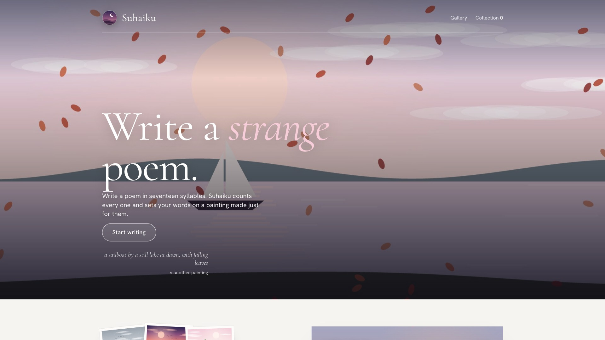

# Suhaiku

*A small museum of haiku, where every painting is composed from the poem hung inside it.*

**Live:** [suhxnitiwari.github.io/suhaiku](https://suhxnitiwari.github.io/suhaiku/) · [demo video](media/suhaiku-demo-web.mp4)

## What it is

You walk into a lit gallery wall of framed prints. Step up to one to read the poem, then go into the
workshop and make your own: write a haiku, senryu or tanka yourself, or give Claude a topic, a mood
and a few words (or a photo) and watch it write while the painting assembles itself underneath, sky first.
Every finished poem can be saved as an image, a phone wallpaper, or a 5-second video.

The entrance is a living painting of the sky outside your window right now, picked from your local time.

## How it's built

**Poems become paintings.** There are no image files behind the art. Each painting is drawn procedurally on
`<canvas>` by a scene composer that layers four choices: sky (9 palettes, from dawn to storm), ground
(9 landscapes, from rolling hills to the open sea), up to two details (a lighthouse, birds on a wire, a street lamp)
and weather. A small lexicon of 36 regex rules reads the poem's words and steers each layer, so a line about
grackles on power lines at dusk gets exactly that. Words that don't fit together are reconciled (a boat with no
ground puts you on a lake). The text is hashed (FNV-1a) into a seed for a deterministic random generator, so
the same poem always paints the same picture.

**Living paintings.** Separate slow layers drift over the still painting (rain, embers, petals, fireflies, falling
leaves), animated with `requestAnimationFrame` and paused when off-screen with an `IntersectionObserver`.

**Video export in the browser.** The 5-second video is rendered frame by frame onto a canvas (slow push-in, live
weather, lines inking in one at a time, a seal stamping at the end) and recorded with `canvas.captureStream` and
`MediaRecorder`, picking MP4 or WebM by what the browser supports, in 9:16 Story or 4:5 post format.

**Writing with Claude.** Prompts carry craft rules (count syllables word by word, concrete images, a banned-cliché list)
and a strict plain-text output format with a syllable count on every line, which the page parses into the poem and
its syllable dots. Claude can also write several drafts, remix a poem (more vivid, sadder, funnier, a twist), finish
a line you started, or give editor's notes as structured JSON. When you write by hand, a local heuristic syllable
counter checks your lines against the form's pattern (5-7-5, or 5-7-5-7-7 for tanka). *Listen* reads the poem aloud
with the Web Speech API.

**One page, two homes.** `src/page.html` is the whole app and is also published as a Claude artifact. `shim.js`
recreates the same `claude.use("sample" | "downloads")` interface on the open web, backed by a streaming serverless
function, and `build.mjs` wraps the two into `public/index.html`.

**A careful public endpoint.** `api/claude.js` (Vercel) streams the reply token by token and keeps the API key on the
server. It caps prompt size at 6,000 characters, accepts one JPEG/PNG/WebP image under 3 MB, rate-limits each visitor to
12 requests a minute, can be locked to one origin, and uses a system prompt that only writes poems (anything else
returns `OFF_TOPIC`). With no key configured, the site runs as a free showcase where everything works except Claude
writing.

| Path | What it is |
|---|---|
| `src/page.html` | The whole app: layout, styles, the painting composer, the video maker |
| `shim.js` | Lets the page run outside Claude: sends poem requests to `/api/claude` and saves downloads in the browser |
| `api/claude.js` | Serverless function that calls Claude with your API key and streams the poem back |
| `build.mjs` | Wraps `src/page.html` + `shim.js` into `public/index.html`. Vercel runs it on every deploy |

## Design choices

- **A museum, not a text box.** The poems hang as framed prints on a lit wall, and you step closer to read them.
- **The poem is the brief.** The painting isn't decoration chosen by a dropdown; it is read out of the words you wrote.
- **Watch it get made.** A new painting builds in four stages (sky, land, details, weather), so writing feels like
  something happening, not a loading spinner.
- **Moods with weather.** Quiet, cozy, tender, wistful, dreamy, funny, dramatic and unhinged each pick their own
  skies and card atmosphere.
- Four poster layouts (classic, centered, staggered, statement) and a lock-screen wallpaper layout that keeps the poem
  clear of the clock.

## Tech stack

Vanilla JavaScript · Canvas 2D · MediaRecorder · Web Speech API · Node serverless function on Vercel · Anthropic SDK

## Deploy your own (Vercel)

1. Create an API key at [console.anthropic.com](https://console.anthropic.com) and add a little credit.
2. In this folder: `npm install -g vercel`, then `vercel`.
3. In the Vercel dashboard, add the environment variable `ANTHROPIC_API_KEY`. Optionally add `ALLOWED_ORIGIN`
   (for example `https://suhaiku.vercel.app`) so other sites can't use your backend.
4. `vercel --prod`.

To preview locally with the backend: `npm run dev`. To change the design, edit `src/page.html` and deploy again.
Each poem is one short request at low effort, usually a fraction of a cent; set a monthly spend limit in the console
so a busy day can't surprise you.

## Ownership

© 2026 Suhani Tiwari. **All rights reserved.** The code is public so you can see how I build, not so you can reuse it. See [LICENSE](LICENSE).

Built by [Suhani Tiwari](https://suhanitiwari.com).
